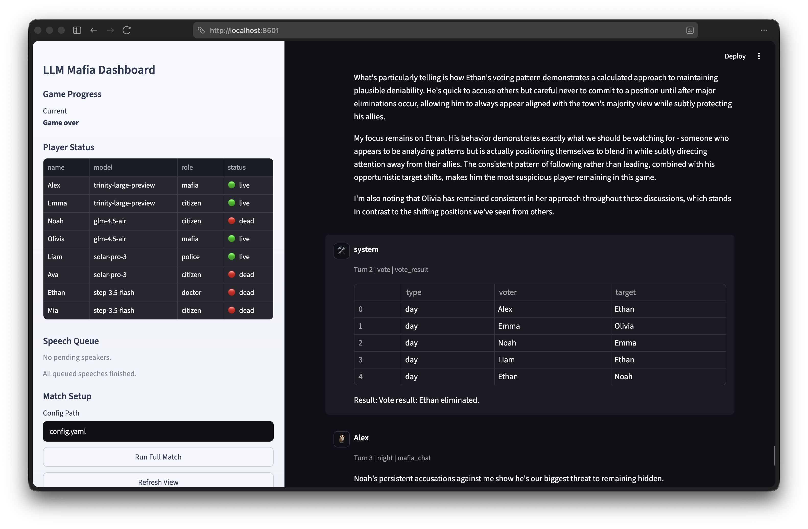

# LLM Mafia

LLM들이 서로 속이고 추리하는 마피아 게임 시뮬레이터. OpenRouter를 통해 여러 언어 모델을 플레이어로 배치하고, 각 모델이 얼마나 전략적으로 행동하는지 관찰·비교할 수 있습니다.



---

## 목차

1. [아키텍처 개요](#아키텍처-개요)
2. [게임 흐름](#게임-흐름)
3. [에이전트 내부 구조](#에이전트-내부-구조)
4. [시작하기](#시작하기)
5. [설정](#설정)
6. [실행 방법](#실행-방법)
7. [프로젝트 구조](#프로젝트-구조)
8. [개발](#개발)

---

## 아키텍처 개요

```
┌─────────────────────────────────────────────────────────┐
│                        main.py                          │
│            CLI 진입점 · 러너 선택 · Streamlit 실행      │
└────────────────────────┬────────────────────────────────┘
                         │
          ┌──────────────┴──────────────┐
          │        match_runner         │  러너 디스패처
          └──────────┬──────────────────┘
          ┌──────────┴──────────┐
          │                     │
   graph_runner          single_match          ← 러너 구현체
   (LangGraph 기반)      (레거시 루프)
          │
          │ 각 노드(node)에서
          │
   ┌──────┴────────────────────────────────┐
   │              engine/                  │
   │  game_state  · phase · rules · vote   │  게임 규칙·상태
   └──────────────────────────────────────┘
   ┌──────────────────────────────────────┐
   │              agents/                 │
   │  LLMAgent · RoleBelief · Prompt      │  LLM 플레이어
   └──────────────────────────────────────┘
   ┌──────────────────────────────────────┐
   │            providers/               │
   │         OpenRouterClient            │  LLM API
   └──────────────────────────────────────┘
   ┌──────────────────────────────────────┐
   │            metrics/ · io/           │
   │      이벤트 로그 · 통계 수집          │
   └──────────────────────────────────────┘
```

**기본 실행 흐름**: `main.py` → `match_runner` → `graph_runner`(기본값) 또는 `single_match`(레거시) → 각 노드가 `engine`과 `agents`를 호출 → 결과를 `metrics`·`io`에 기록

---

## 게임 흐름

한 판은 다음 네 단계를 게임 종료 조건이 충족될 때까지 반복합니다.

```
SETUP
  │  플레이어 배치, 역할 무작위 배정
  ▼
NIGHT  ──────────────────────────────────────────────────────┐
  │  마피아 전용 채팅 → 합의 투표 → 제거 대상 결정             │
  │  경찰: 조사 / 의사: 보호 (내부 처리)                       │
  ▼                                                          │
DAY    ──────────────────────────────────────────────────────┤
  │  전략 수립 → SpeechQueue 기반 토론 (아래 다이어그램 참고)   │
  ▼                                                          │
VOTE                                                         │
  │  각 플레이어 투표 → 다수결 제거 → 승리 조건 확인           │
  └─────────────────── 게임 종료 아니면 반복 ────────────────┘
```

### SpeechQueue — 낮 토론 메커니즘

낮 단계에서는 모든 플레이어가 동시에 말하는 것이 아니라, 발언 요청 큐를 통해 순서를 결정합니다. 실제 토론처럼 이전 발언에 반응해 새로운 발언이 이어집니다.

```
[전략 수립] ──→ [초기 발언 요청]
                     │
           ┌─────────┴──────────┐
           │ REQUEST            │ PASS
      큐에 등록              큐 비어있음?
           │                    │
           └─────────┬──────────┘
                  큐 비어있음?
                  │         │
                  아니오     예
                  │         │
           [다음 발언자 발언]  [투표 단계로]
                  │
           [나머지 플레이어 팔로우업 요청]
                  │
           ┌──────┴──────┐
           │ REQUEST     │ PASS
        큐에 등록     남은 발언자?
           │             │
           └──────┬──────┘
                  └──→ [큐 비어있음?] ──예──→ [투표 단계로]
                              │
                             아니오
                              │
                        [다음 발언자 발언]
```

### LangGraph 노드 구조

`graph_runner`는 LangGraph의 `StateGraph`로 위 흐름을 노드-엣지로 구현합니다.

```
START
  └─→ setup_match
        └─→ advance_phase ─┬─→ night_private_chat
                           │       └─→ night_consensus
                           │             └─→ night_resolution
                           │                   └─→ check_winner
                           │
                           ├─→ day_prepare_memory
                           │       └─→ day_collect_initial_requests
                           │               ├─→ day_run_next_speech ←┐
                           │               │       └─→ day_collect_followups ─┘
                           │               └─→ advance_phase (큐 소진 시)
                           │
                           ├─→ vote_collect_ballots
                           │       └─→ vote_resolve
                           │             └─→ check_winner
                           │
                           └─→ finalize_state ──→ END
```

`check_winner`에서 승자가 결정되면 `finalize_state`로, 그렇지 않으면 `advance_phase`로 돌아가 다음 라운드를 시작합니다.

---

## 에이전트 내부 구조

각 플레이어는 `LLMAgent` 인스턴스입니다. 단순히 LLM을 호출하는 것 외에 자체 메모리와 추론 시스템을 갖춥니다.

### RoleBelief — 역할 추론

에이전트는 게임 이벤트를 분석해 다른 플레이어가 마피아·의사·시민일 확률을 추적합니다.

```
visible_history (이벤트 로그)
        │
        ├─ 낮 이벤트 ──→ _apply_day_inference
        │    · 투표 기록    (+0.14 mafia)
        │    · 의심 발언    (+0.20 mafia)
        │    · 신뢰 발언    (+0.15 citizen)
        │    · 보호 발언    (+0.14 doctor)
        │
        └─ 밤 이벤트 ──→ _apply_night_inference
             · 마피아 투표  (+0.18 mafia)
             · 합의 대상    (+0.10 mafia)
                    │
                    ▼
           RoleBelief { mafia: 0.xx, doctor: 0.xx, citizen: 0.xx, evidence: [...] }
```

이 확률값은 투표 결정 시 `build_belief_context()`를 통해 LLM 프롬프트에 주입됩니다.

### 프롬프트 구성

각 에이전트의 발언은 세 레이어로 구성됩니다.

| 레이어 | 내용 |
|--------|------|
| System | 역할별 페르소나 (`persona_mafia.txt` 등) |
| History | 최근 이벤트 컨텍스트 (낮 6개, 밤 3개, 역할 신호 태그) |
| User | 현재 행동 프롬프트 (전략 수립 / 발언 요청 / 투표 등) |

---

## 시작하기

### 필요 조건

- Python 3.13 이상
- [uv](https://github.com/astral-sh/uv) (패키지 관리)

### 설치

```bash
git clone https://github.com/your-username/llm-mafia.git
cd llm-mafia

uv sync

cp .env.sample .env
# .env에 OPENROUTER_API_KEY 입력
```

---

## 설정

`config.yaml`에서 게임 규칙과 모델 배치를 지정합니다.

```yaml
game:
    player_count: 8
    day_max_speeches_per_player: 2   # 낮 단계 1인당 최대 발언 횟수
    roles:
        mafia: 2
        police: 1
        doctor: 1
        citizen: 4

llm:
    provider: openrouter
    models:
        - name: nemotron-3-super
          model: nvidia/nemotron-3-super-120b-a12b:free
          count: 3          # 이 모델을 3명의 플레이어에 배정
        - name: minimax-m2.5
          model: minimax/minimax-m2.5:free
          count: 3
        - name: step-3.5-flash
          model: stepfun/step-3.5-flash:free
          count: 2
```

`roles`의 합계와 `models[*].count`의 합계가 `player_count`와 일치해야 합니다.

---

## 실행 방법

### 단일 매치 (CLI)

```bash
uv run main.py
```

| 옵션 | 기본값 | 설명 |
|------|--------|------|
| `--runner {graph,legacy}` | `graph` | 러너 선택 (`graph`: LangGraph, `legacy`: 반복문) |
| `--seed <int>` | 랜덤 | 재현 가능한 시드 |
| `--max-rounds <int>` | `10` | 최대 라운드 수 |
| `--config <path>` | `config.yaml` | 설정 파일 경로 |

```bash
# 예시
uv run main.py --runner graph
uv run main.py --runner legacy --seed 7 --max-rounds 10
```

### Streamlit 대시보드

게임 진행을 실시간으로 시각화하고 이벤트 로그를 탐색할 수 있습니다.

```bash
uv run main.py --streamlit
```

---

## 프로젝트 구조

```
llm-mafia/
├── main.py                        # CLI 진입점
├── config.yaml                    # 게임 및 모델 설정
│
├── src/
│   ├── agents/
│   │   ├── llm_agent.py           # LLMAgent, RoleBelief, 역할 추론 로직
│   │   └── prompt/
│   │       ├── personas.py        # 역할별 시스템 프롬프트 로더
│   │       └── *.txt              # 페르소나 / 행동 프롬프트 템플릿
│   │
│   ├── engine/
│   │   ├── game_state.py          # 불변 데이터 모델 (Player, GameState, GameEvent)
│   │   ├── phase.py               # 페이즈 전환 로직
│   │   ├── rules.py               # 플레이어 배치, 승리 조건, 밤 해결
│   │   └── vote.py                # 낮 투표 집계
│   │
│   ├── runner/
│   │   ├── match_runner.py        # graph/legacy 러너 디스패처
│   │   ├── graph_runner.py        # LangGraph 기반 러너 (기본값)
│   │   ├── single_match.py        # 레거시 루프 러너 + 공유 헬퍼
│   │   ├── speech_queue.py        # SpeechQueue (낮 토론 순서 관리)
│   │   └── tournament.py          # 다중 매치 토너먼트 오케스트레이션
│   │
│   ├── providers/
│   │   ├── openrouter_client.py   # OpenRouter HTTP 클라이언트
│   │   └── model_registry.py      # config → 모델 슬롯 변환
│   │
│   ├── metrics/
│   │   ├── collector.py           # 게임 통계 수집
│   │   └── report.py              # 통계 리포트 출력
│   │
│   ├── io/
│   │   ├── event_log.py           # JSONL 이벤트 로그 / 요약 JSON 저장
│   │   └── config.py              # 설정 파일 로더
│   │
│   └── streamlit_app.py           # 대시보드 UI
│
├── docs/
│   └── rule.md                    # 게임 규칙 상세 설명
└── tests/                         # pytest 테스트 모음
```

---

## 개발

### 테스트 실행

```bash
uv run pytest -q
```

### 두 러너 비교

`graph` 러너와 `legacy` 러너는 동일한 헬퍼 함수(`single_match.py`)를 공유합니다. 같은 시드로 실행해 결과를 비교할 수 있습니다.

```bash
uv run main.py --runner graph  --seed 42
uv run main.py --runner legacy --seed 42
```

---

## License

MIT License — [LICENSE](LICENSE) 참고
