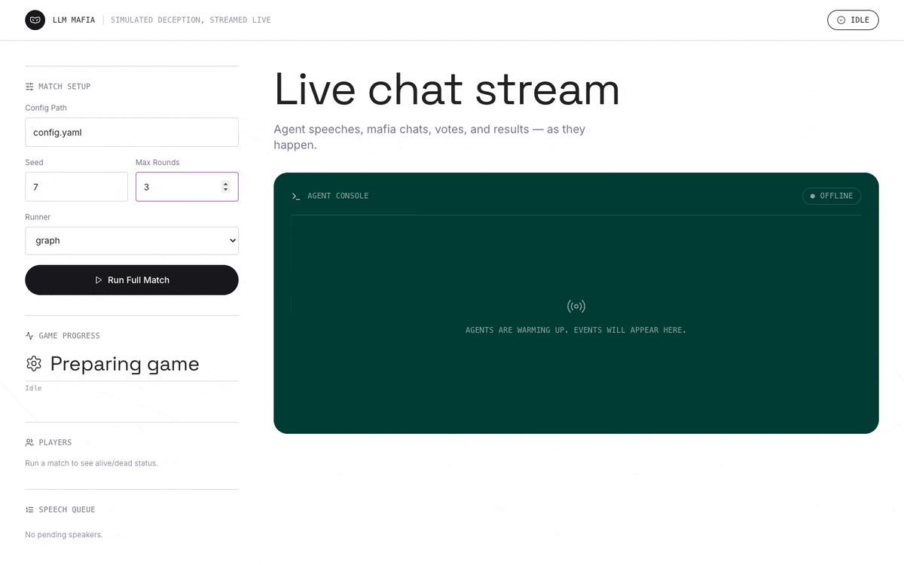

# LLM Mafia

A Mafia game simulator where LLMs deceive and reason against each other. Multiple language models are seated as players through OpenRouter, so you can observe and compare how strategically each model behaves.



---

## Table of Contents

1. [Architecture Overview](#architecture-overview)
2. [Game Flow](#game-flow)
3. [Agent Internals](#agent-internals)
4. [Getting Started](#getting-started)
5. [Configuration](#configuration)
6. [Usage](#usage)
7. [Project Structure](#project-structure)
8. [Development](#development)

---

## Architecture Overview

```
┌─────────────────────────────────────────────────────────┐
│                        main.py                          │
│     CLI entrypoint · runner selection · web dashboard   │
└────────────────────────┬────────────────────────────────┘
                         │
          ┌──────────────┴──────────────┐
          │        match_runner         │  runner dispatcher
          └──────────┬──────────────────┘
          ┌──────────┴──────────┐
          │                     │
   graph_runner          single_match          ← runner implementations
   (LangGraph-based)     (legacy loop)
          │
          │ from each node
          │
   ┌──────┴────────────────────────────────┐
   │              engine/                  │
   │  game_state  · phase · rules · vote   │  game rules & state
   └──────────────────────────────────────┘
   ┌──────────────────────────────────────┐
   │              agents/                 │
   │  LLMAgent · RoleBelief · Prompt      │  LLM players
   └──────────────────────────────────────┘
   ┌──────────────────────────────────────┐
   │            providers/               │
   │         OpenRouterClient            │  LLM API
   └──────────────────────────────────────┘
   ┌──────────────────────────────────────┐
   │            metrics/ · io/           │
   │     event logs · stats collection    │
   └──────────────────────────────────────┘
```

**Default execution flow**: `main.py` → `match_runner` → `graph_runner` (default) or `single_match` (legacy) → each node calls `engine` and `agents` → results are recorded via `metrics` and `io`.

---

## Game Flow

A match repeats the following phases until a win condition is met.

```
SETUP
  │  seat players, assign roles at random
  ▼
NIGHT  ──────────────────────────────────────────────────────┐
  │  mafia-only chat → consensus vote → choose elimination    │
  │  police: investigate / doctor: protect (internal)         │
  ▼                                                          │
DAY    ──────────────────────────────────────────────────────┤
  │  plan strategy → SpeechQueue-based discussion (see below) │
  ▼                                                          │
VOTE                                                         │
  │  every player votes → majority elimination → win check    │
  └──────────────────── repeat unless game over ─────────────┘
```

### SpeechQueue — Day Discussion Mechanism

During the day, players do not all speak at once. A speech-request queue decides the order, so new speeches follow up on earlier ones like a real debate.

```
[plan strategy] ──→ [initial speech requests]
                     │
           ┌─────────┴──────────┐
           │ REQUEST            │ PASS
      enqueue               queue empty?
           │                    │
           └─────────┬──────────┘
                 queue empty?
                  │         │
                  no        yes
                  │         │
         [next speaker talks]  [go to vote]
                  │
         [follow-up requests from other players]
                  │
           ┌──────┴──────┐
           │ REQUEST     │ PASS
        enqueue      speakers left?
           │             │
           └──────┬──────┘
                  └──→ [queue empty?] ──yes──→ [go to vote]
                              │
                              no
                              │
                     [next speaker talks]
```

### LangGraph Node Structure

`graph_runner` implements the flow above as nodes and edges in a LangGraph `StateGraph`.

```
START
  └─→ setup_match
        └─→ advance_phase ─┬─→ night_private_chat
                           │       └─→ night_consensus
                           │             └─→ night_resolution
                           │                   └─→ check_winner
                           │
                           ├─→ day_prepare_memory
                           │       └─→ day_collect_initial_requests
                           │               ├─→ day_run_next_speech ←┐
                           │               │       └─→ day_collect_followups ─┘
                           │               └─→ advance_phase (when queue is drained)
                           │
                           ├─→ vote_collect_ballots
                           │       └─→ vote_resolve
                           │             └─→ check_winner
                           │
                           └─→ finalize_state ──→ END
```

If `check_winner` finds a winner, the graph moves to `finalize_state`; otherwise it returns to `advance_phase` and starts the next round.

---

## Agent Internals

Each player is an `LLMAgent` instance. Beyond calling an LLM, it keeps its own memory and inference system.

### RoleBelief — Role Inference

Agents analyze game events and track the probability that each other player is mafia, doctor, or citizen.

```
visible_history (event log)
        │
        ├─ day events ──→ _apply_day_inference
        │    · vote records       (+0.14 mafia)
        │    · suspicious speech  (+0.20 mafia)
        │    · trusting speech    (+0.15 citizen)
        │    · protective speech  (+0.14 doctor)
        │
        └─ night events ──→ _apply_night_inference
             · mafia vote         (+0.18 mafia)
             · consensus target   (+0.10 mafia)
                    │
                    ▼
           RoleBelief { mafia: 0.xx, doctor: 0.xx, citizen: 0.xx, evidence: [...] }
```

These probabilities are injected into the LLM prompt through `build_belief_context()` when the agent decides how to vote.

### Prompt Composition

Each agent's output is built from three layers.

| Layer | Content |
|-------|---------|
| System | Role-specific persona (`persona_mafia.txt`, etc.) |
| History | Recent event context (6 day events, 3 night events, role-signal tags) |
| User | Current action prompt (strategy / speech request / vote, etc.) |

---

## Getting Started

### Requirements

- Python 3.13+
- [uv](https://github.com/astral-sh/uv) (package management)

### Installation

```bash
git clone https://github.com/your-username/llm-mafia.git
cd llm-mafia

uv sync

cp .env.sample .env
# put your OPENROUTER_API_KEY in .env
```

---

## Configuration

`config.yaml` defines the game rules and model seating.

```yaml
game:
    player_count: 8
    day_max_speeches_per_player: 2   # max speeches per player during the day
    roles:
        mafia: 2
        police: 1
        doctor: 1
        citizen: 4

llm:
    provider: openrouter
    models:
        - name: nemotron-3-super
          model: nvidia/nemotron-3-super-120b-a12b:free
          count: 3          # seat this model as 3 players
        - name: minimax-m2.5
          model: minimax/minimax-m2.5:free
          count: 3
        - name: step-3.5-flash
          model: stepfun/step-3.5-flash:free
          count: 2
```

The sum of `roles` and the sum of `models[*].count` must both equal `player_count`.

---

## Usage

### Single match (CLI)

```bash
uv run main.py
```

| Option | Default | Description |
|--------|---------|-------------|
| `--runner {graph,legacy}` | `graph` | Runner selection (`graph`: LangGraph, `legacy`: loop) |
| `--seed <int>` | random | Seed for reproducible runs |
| `--max-rounds <int>` | `10` | Maximum number of rounds |
| `--config <path>` | `config.yaml` | Config file path |

```bash
# examples
uv run main.py --runner graph
uv run main.py --runner legacy --seed 7 --max-rounds 10
```

### Web dashboard (HTML + JS)

Visualizes the match in real time. The browser connects to a FastAPI server over SSE (Server-Sent Events) and streams speeches, votes, and results as they happen. The UI follows [`DESIGN.md`](DESIGN.md) and uses inline SVG icons.

```bash
uv run main.py --web
```

| Option | Default | Description |
|--------|---------|-------------|
| `--web` | off | Launch the web dashboard (instead of a CLI match) |
| `--host <str>` | `127.0.0.1` | Dashboard bind host |
| `--port <int>` | `8000` | Dashboard port |

```bash
# example
uv run main.py --web --port 9000
```

---

## Project Structure

```
llm-mafia/
├── main.py                        # CLI entrypoint
├── config.yaml                    # game and model settings
├── DESIGN.md                      # dashboard design system
│
├── src/
│   ├── agents/
│   │   ├── llm_agent.py           # LLMAgent, RoleBelief, role inference logic
│   │   └── prompt/
│   │       ├── personas.py        # role-specific system prompt loader
│   │       └── *.txt              # persona / action prompt templates
│   │
│   ├── engine/
│   │   ├── game_state.py          # immutable data models (Player, GameState, GameEvent)
│   │   ├── phase.py               # phase transition logic
│   │   ├── rules.py               # seating, win conditions, night resolution
│   │   └── vote.py                # day vote tally
│   │
│   ├── runner/
│   │   ├── match_runner.py        # graph/legacy runner dispatcher
│   │   ├── graph_runner.py        # LangGraph-based runner (default)
│   │   ├── single_match.py        # legacy loop runner + shared helpers
│   │   ├── speech_queue.py        # SpeechQueue (day discussion ordering)
│   │   └── tournament.py          # multi-match tournament orchestration
│   │
│   ├── web/
│   │   ├── server.py              # FastAPI app (static serving + REST/SSE API)
│   │   ├── match_session.py       # background match session + SSE event hub
│   │   ├── view_model.py          # progress payload → view state logic
│   │   └── static/
│   │       ├── index.html         # dashboard HTML
│   │       ├── style.css          # dashboard styles (based on DESIGN.md)
│   │       ├── icons.js           # inline SVG icons (Lucide, no emoji)
│   │       └── app.js             # SSE subscription and rendering logic
│   │
│   ├── providers/
│   │   ├── openrouter_client.py   # OpenRouter HTTP client
│   │   └── model_registry.py      # config → model slot conversion
│   │
│   ├── metrics/
│   │   ├── collector.py           # game statistics collection
│   │   └── report.py              # statistics report output
│   │
│   └── io/
│       ├── event_log.py           # JSONL event log / summary JSON writer
│       └── config.py              # config file loader
│
├── docs/
│   └── rule.md                    # detailed game rules
└── tests/                         # pytest test suite
```

---

## Development

### Running tests

```bash
uv run pytest -q
```

### Comparing the two runners

The `graph` and `legacy` runners share the same helper functions (`single_match.py`). Run both with the same seed to compare results.

```bash
uv run main.py --runner graph  --seed 42
uv run main.py --runner legacy --seed 42
```

---

## License

MIT License — see [LICENSE](LICENSE)
